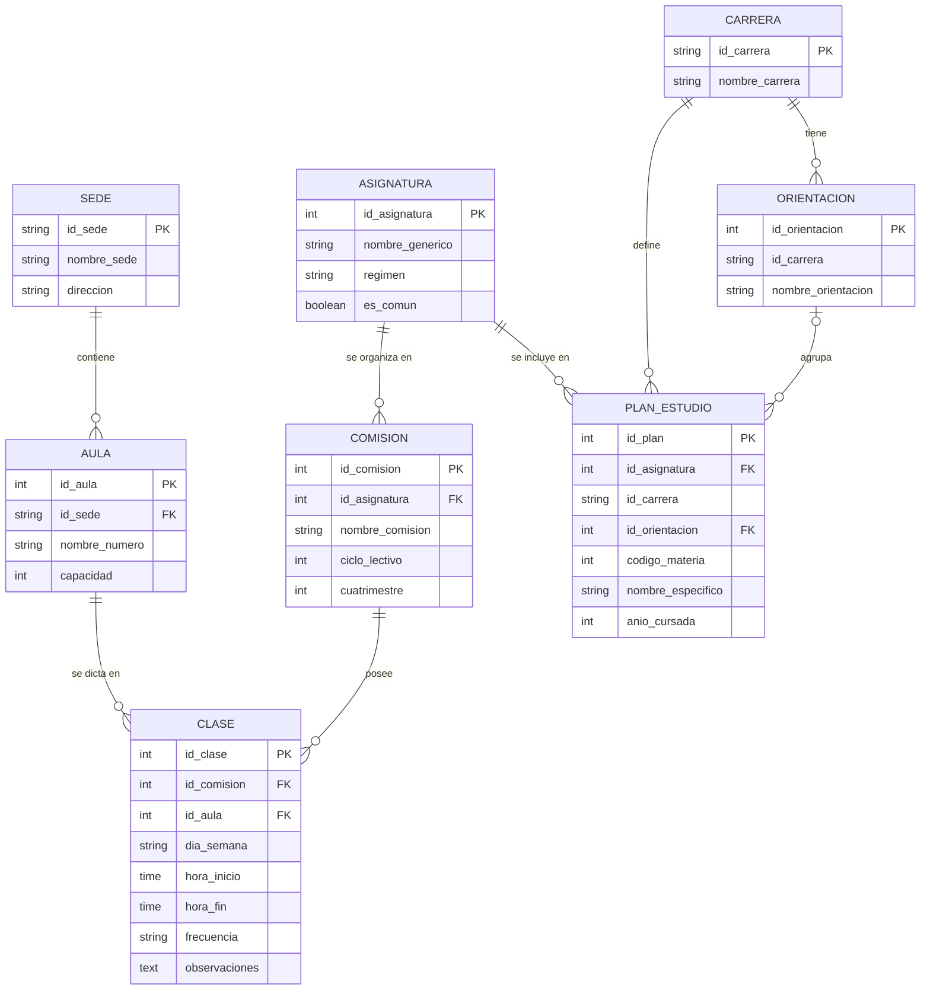

# Sistema de Consulta de Horarios Académicos

Aplicación web de una sola página para consultar los horarios de cursada de distintas carreras en formato de calendario semanal. Los datos se obtienen desde una base de datos [Supabase](https://supabase.com/) y se presentan mediante [FullCalendar](https://fullcalendar.io/).

Actualmente cubre las carreras de Ingeniería Química e Ingeniería en Alimentos, con filtros por año de cursada y cuatrimestre.

## Características

- Vista semanal de lunes a sábado, en el rango de 07:00 a 21:00.
- Filtros por carrera, año de cursada (3º, 4º y 5º) y cuatrimestre (1º y 2º).
- Cada evento indica la asignatura, el aula y la sede.

## Tecnologías

| Tecnología | Uso |
|---|---|
| HTML, CSS y JavaScript | Interfaz y lógica del cliente |
| FullCalendar 6.1.8 | Calendario semanal (`timeGridWeek`) |
| Supabase JS v2 | Cliente de acceso a la base de datos |

## Modelo de base de datos

La base de datos está implementada en PostgreSQL (Supabase) y se compone de ocho tablas.

### Diagrama entidad-relación

### Descripción de las tablas

| Tabla | Descripción |
|---|---|
| `sede` | Edificios o sedes donde se dictan las clases. |
| `aula` | Aulas de cada sede, con su capacidad. |
| `carrera` | Carreras disponibles. |
| `asignatura` | Materias en su forma genérica, con régimen de cursada (anual o cuatrimestral) e indicador de materia común a varias carreras. |
| `orientacion` | Orientaciones de cada carrera. |
| `comision` | Comisiones de una asignatura para un ciclo lectivo y cuatrimestre. |
| `plan_estudio` | Vincula cada asignatura con una carrera (y orientación, si corresponde), con su código, nombre específico y año de cursada. |
| `clase` | Encuentros semanales de una comisión: día, horario, aula, frecuencia y observaciones. |

Una misma asignatura puede figurar en el plan de estudios de varias carreras, con un nombre específico y un año de cursada propios en cada una.

## Funcionamiento

1. Al cargar la página se inicializa el calendario y se invoca `cargarHorarios()`.
2. La función lee los filtros seleccionados y consulta las clases correspondientes en Supabase.
3. Cada registro se convierte en un evento semanal recurrente (`daysOfWeek`, `startTime`, `endTime`), utilizando el mapa `diasMapa` para traducir el nombre del día a su valor numérico.
4. Se eliminan los eventos previos y se cargan los nuevos en el calendario.

## Configuración para uso propio

Para utilizar un proyecto propio de Supabase:

1. Crear las tablas descritas en la sección Modelo de base de datos.
2. Reemplazar `SUPABASE_URL` y `SUPABASE_ANON_KEY` por los valores del proyecto (Project Settings, sección API). Ambas constantes se definen al inicio del script de `index.html`.
3. Habilitar Row Level Security (RLS) con una política de solo lectura (`SELECT`) en las tablas consultadas.

## Mejoras previstas

- Diferenciar visualmente las asignaturas.
- Informar al usuario cuando no existan resultados o se produzca un error de conexión.
- Filtrar, dentro de una misma materia, los horarios de teoría/coloquio y de laboratorio.
